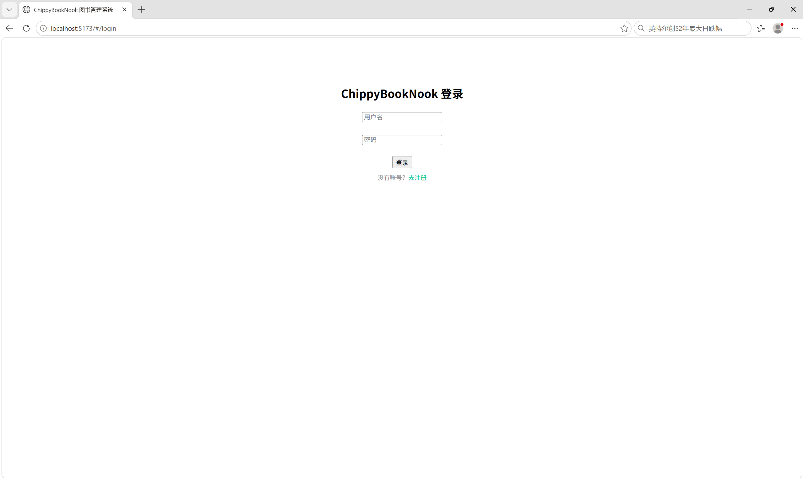
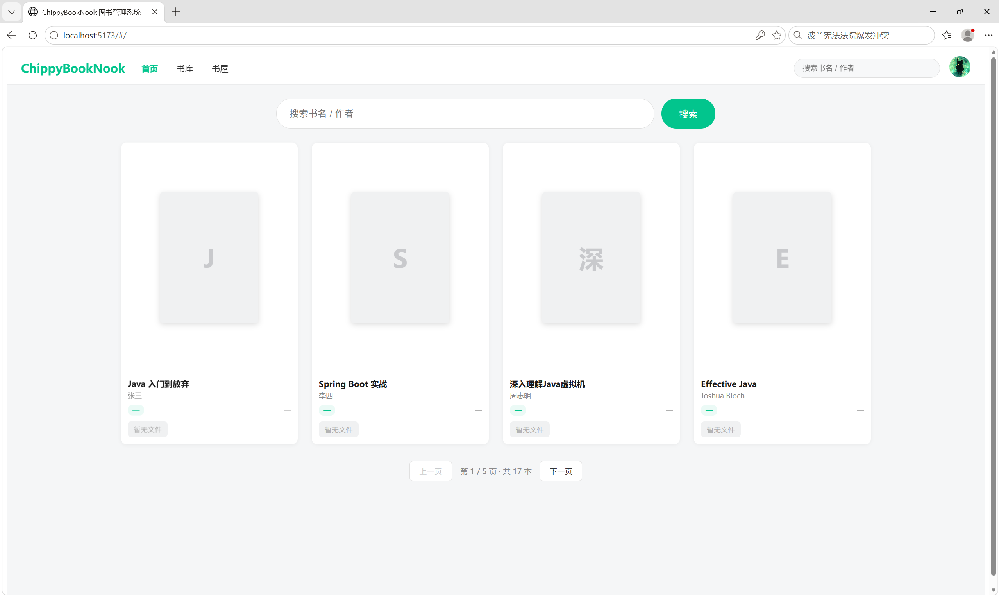
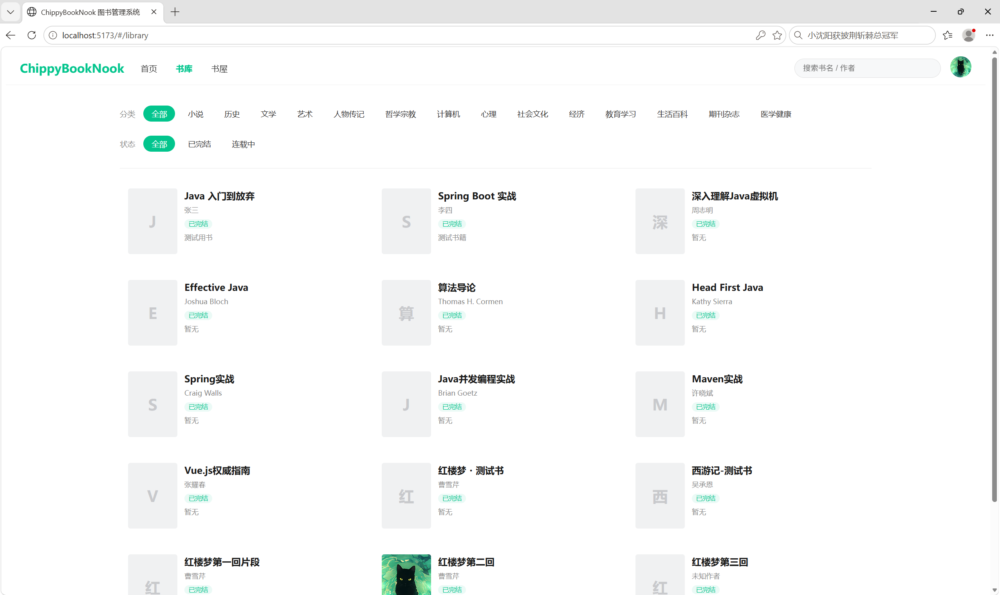
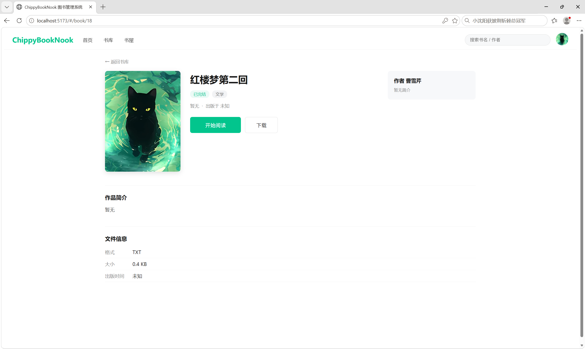

# ChippyBookNook 个人图书管理系统

前后端分离的个人图书管理系统，包含用户注册登录、书库检索、图书上传下载、在线阅读、个人书架、读书笔记、借阅流转和管理员权限等核心模块。

## 技术栈

| 端 | 技术 |
| --- | --- |
| 后端 | Spring Boot 3.5、MyBatis-Plus、MySQL 8、JWT、Swagger |
| 前端 | Vue 3、Vite、vue-router、axios |
| 部署 | 前后端构建为单 jar，前端使用 hash 路由 |

## 功能清单

- 用户注册登录：JWT 无状态认证，后端拦截器校验 + 前端路由守卫双重登录态控制
- 书库检索：关键词模糊搜索、分类/状态筛选、分页查询
- 图书上传下载：支持 TXT / PDF / EPUB 三种格式，自动统计字数，在线预览与下载
- 个人书架：未读 / 在读 / 已读阅读状态管理
- 读书笔记：自己的书和借来的书都可以写笔记
- 借阅流转：借书时校验"不能借自己的书、书未被借走"，还书后自动移出个人书屋
- 管理员权限：用户管理、书库管理

## 界面预览

| 登录页 | 首页（书库） |
| --- | --- |
|  |  |

| 书库（分类/状态筛选） | 图书详情页 |
| --- | --- |
|  |  |

## 项目结构

```
ChippyBookNook
├── src/main/java          # 后端源码（controller / service / entity / config / util）
├── src/main/resources     # 后端配置（application.yml、application-example.yml）
├── frontend               # 前端源码（Vue 3 + Vite）
├── sql                    # 建库建表脚本（chippy_library_1.sql）
└── pom.xml                # Maven 配置
```

## 快速启动

环境要求：JDK 17+、Maven、Node.js 16+、MySQL 8

第 1 步：创建数据库
使用 MySQL 客户端执行 `sql/chippy_library_1.sql`（会创建 `chippy_library` 库、5 张表，并写入默认账号）。

第 2 步：配置后端
复制 `src/main/resources/application-example.yml` 为 `application.yml`，将数据库账号密码改为你自己的，并把 `jwt.secret` 改成随机字符串。

第 3 步：启动后端
在项目根目录执行 `mvn spring-boot:run`，后端运行在 9090 端口（Swagger 文档：http://localhost:9090/swagger-ui.html）。

第 4 步：启动前端
```
cd frontend
npm install
npm run dev
```
前端运行在 5173 端口，vite 已配置代理，`/api` 请求会自动转发到后端 9090。

第 5 步：登录
浏览器访问 http://localhost:5173 ，使用默认账号登录：管理员 `admin / 123456`，普通用户 `user1 / 123456`。

## 部署（单 jar）

```
cd frontend && npm run build
cd ..
mvn package
```
打包出的 jar 已包含前端静态资源，运行 `java -jar target/chippy-booknook-*.jar` 即可，访问 http://localhost:9090 。前端采用 hash 路由，刷新不会 404。

## 说明

- 上传的图书和封面保存在 `uploads/` 目录（相对程序运行目录），该目录已在 .gitignore 中排除
- `application.yml` 为本地真实配置（数据库账号、JWT 密钥），未纳入版本控制，仓库中提供 `application-example.yml` 模板
